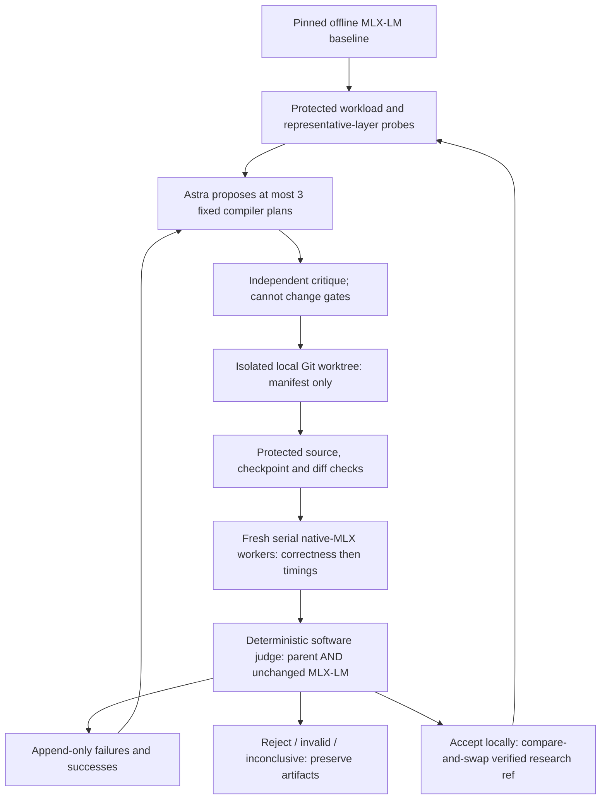

# Miki: bounded empirical optimization inside Strata

Updated October 3, 2026. Status: implemented **project-local experimental
controller**, with offline/synthetic contract validation. The physical MLX-LM
baseline is blocked by the internal-SSD reserve. No candidate has a measured
full-model win, no Astra proposal has been obtained, and no plan is promoted.

Miki preserves Strata's existing Metal, Objective-C ANE, C/NEON and C++ work.
It is not a replacement runtime or a CommonCompute release. The initial family
searches native MLX compiler plans, not arbitrary generated Metal source. The
[native architecture-search design](BOUNDED_ARCHITECTURE_SEARCH.md) and its
stricter full-runtime promotion gates remain in force.

## What runs, and what is still missing

| Layer | Implemented in this checkpoint | Evidence boundary |
| --- | --- | --- |
| Inference reference | Offline pinned local MLX-LM models and its unchanged `generate_step` | This run has not passed model admission |
| Initial candidates | Compile dense Q4 MLPs for decode, prefill, or both using `mx.compile` | Tensor math is MLX-native; compiler/real-model parity is unverified |
| Experiment control | Serial workers, isolated Git worktrees, immutable manifests, finite deadlines | Protected Python orchestration, not a native serving daemon |
| Correctness | Greedy tokens, logits, KV arrays/offsets, finite values, parameter-byte parity | Fixed synthetic prompt ladder; not an independent general model-quality suite |
| Performance judge | Repeated paired measurements, two fresh-process replications, noise/memory/latency limits | Synthetic tests prove policy/control flow, not speed |
| History | SQLite append API with update/delete triggers, hash chain, hashed raw JSON | Not OS-enforced immutability or proof against tail truncation |
| Research provider | Replaceable interface and structured read-only Codex/Astra adapter | CLI contract verified; a live request has not been made |
| Native Strata kernels | Existing packed Q4 and fused SwiGLU shaders, Objective-C++ Metal host, reverse-engineered ANE probes | Retained and compiled separately; not used by this initial candidate family |
| Serving/wrappers/fleet | No new serving endpoint or production wrapper | Targets remain gated separately |

## Topology and trust boundaries



The proposer receives bounded public-source, hardware-class, profile and
matched-model history context. It is not the judge. Its working directory is
empty and read-only; user configuration is ignored, and tool use in its event
stream is rejected. This is not a filesystem privacy/security sandbox: a
read-only process can still read files if the contract is violated. Do not add
secrets or private fleet/customer prompts to this research interface.

Candidate code cannot change the worker. The only mutable file is
`miki_candidate.json`, containing exactly `schema_version` and `mode`.
An enum selects protected implementation. No LLM-generated Python, shell,
Objective-C or Metal source is executed in this initial family.

## Source layout

| Path | Responsibility |
| --- | --- |
| `src/lokahi/lab/cli.py`, `system.py` | Commands, non-identifying hardware identity and admission |
| `src/lokahi/lab/runtime.py` | Prepared native-MLX compiler plans and guaranteed model restoration |
| `src/lokahi/lab/bench/workloads.py` | Frozen prompt/output lengths and public prompt fixtures |
| `src/lokahi/lab/bench/worker.py` | Offline reference/candidate calls, state parity and raw measurements |
| `src/lokahi/lab/bench/runner.py` | Serial bounded fresh-process dispatch and failure packets |
| `src/lokahi/lab/bench/statistics.py` | Finite samples, summaries and deterministic paired bootstrap |
| `src/lokahi/lab/optimizer/integrity.py`, `candidate.py` | No-follow source digests, exact candidate diffs and local checkpoints |
| `src/lokahi/lab/optimizer/judge.py`, `orchestrator.py` | Immutable acceptance policy, bounded generations and reproduction |
| `src/lokahi/lab/optimizer/researcher.py`, `proposal.schema.json` | Replaceable proposer/critic and output contract |
| `src/lokahi/lab/experiments/` | Append-only history API and exclusive hashed artifacts |
| `tests/test_lab_empirical.py` | Synthetic controller/integrity/statistics/ancestry tests |
| `research/hardware_atlas/` | Dated physical facts, sources and explicit unknowns |

Protected digests cover `AGENTS.md`, `pyproject.toml`, and relevant source,
tests, benchmark and native files. Added/deleted protected files also invalidate
an experiment. A candidate's manifest, clean worktree, HEAD, parent, exact diff
and diff hash must match. Documentation changes are not candidate code; new
policies must still be reviewed, committed and assigned a new baseline.

## Initial family and evidence-driven limits

Only exact MLX-LM dense `llama.Model` and `qwen3.Model` classes are eligible.
Every MLP gate/up/down projection must be an unchanged affine 4-bit
`QuantizedLinear`, group size 64. Limit: 1..64 layers, batch 1, decode row 1,
prefill rows 2..512. Other shapes fall back explicitly and count as such; a
requested candidate must execute to qualify. Unsupported semantics reject.

Compiled functions stay alive across correctness, warmups and measured
requests. Their closures reference original MLP weights; no full expanded
weight shadow or requantization is intended. Parameter-byte parity is checked.
Installing/restoring wrappers happens outside request timing; model calls,
MLX-LM scheduling and final synchronization remain inside it. Original modules
are restored even on exceptions. Persistent compiler artifacts/allocator memory
can remain in a paired worker, so matched single-route fresh-process memory
probes are also mandatory.

Three non-control variants: `compile_decode`, `compile_prefill`,
`compile_both`. Zero to three may survive independent critique. At most three
proposals per generation, two generations per invocation, and 60..3,600 seconds
overall; default 1,800. At most two measurement looks per candidate. No infinite
recursion, package installation, automatic hardware/fleet jobs, global security
changes, or remote publication. Failure to configure Astra is a recorded block,
not permission to substitute a different research model.

Profile probes measure the first layer's MLP, normalization and gate/up
projections at rows 1 and 64. These overlapping operations are **not additive**
whole-request attribution. The controller searches this family only when that
limited profile nominates it. It does not claim that the largest isolated
operator is the whole-model bottleneck, nor pretend to tune attention/ANE/SSD
when it only has MLP evidence.

## Frozen workloads and correctness

| Workload | Prompt tokens | Generated tokens | Batch | Cache |
| --- | --- | --- | --- | --- |
| interactive | 64 | 32 | 1 | fresh per request |
| prefill | 256 | 32 | 1 | fresh per request |

Public repeated-text token fixtures, no chat template/network/vision. Exactly
32 greedy token IDs are required, even beyond a model's normal EOS convention:
this fixes work but is not a production conversation test. Both routes use the
same unchanged MLX-LM generator and asynchronous lookahead behavior.

Before timing, compare a 64-token prefill plus three cached one-token calls:
greedy token IDs and KV offsets must match exactly; logits and all KV arrays
must be finite, shape-equivalent, and pass `atol=0.002`, `rtol=0.005`, relative
L2 <=0.005. Parameter bytes must match. Complete timed requests must also have
identical greedy IDs at both prompt lengths. These limits are immutable during
search. Compilation/correctness failure cannot be rescued by changing them.

Models are locally pinned and independently SHA-256 recorded:

- `mlx-community/Llama-3.2-3B-Instruct-4bit` at
  `7f0dc925e0d0afb0322d96f9255cfddf2ba5636e` (initial target).
- `mlx-community/Qwen3-0.6B-4bit` at
  `73e3e38d981303bc594367cd910ea6eb48349da8` (canary).

No downloads, `trust_remote_code=False`, and offline Hub/Transformers flags.
Artifact paths and provenance are checked without following symlinks. Gemma,
GLM, DeepSeek, GPT-OSS, hybrid Qwen3.5 and VLM support are **not established by
this family**, irrespective of the broader dated CommonCompute catalog.

## Metrics and immutable decisions

Three warmups per route and workload. First look: five interleaved matched
pairs in each of two fresh workers, totaling ten per workload. Inconclusive,
non-resource-blocked results may get one new expanded look of fifteen pairs
per worker (thirty per workload). Preserve both looks; do not merge cherry-picked
samples. Seed 730 + replication rotates pair order. Later generations include a
third unchanged MLX-LM route, not just the current verified parent.

Each raw packet records model files/revision, architecture/quantization, chip
and OS/compiler/software identity, tensor shape/dtype where probed, workload,
output IDs/arrival timestamps, backend calls/fallbacks, admission before/after,
compile/correctness evidence and exact timing boundaries. SQLite events add
experiment/ancestry/generation, code/diff/protected hashes, proposals/critique,
comparison, memory, decision and artifact hash/path. Raw JSON stays external.

| Metric | Definition / limitation |
| --- | --- |
| TTFT | Time from generator start to first returned integer token |
| Decode tokens/s | `(N-1)/(last_arrival-first_arrival)`; N=32 |
| Request wall / goodput | Start through final MLX synchronization; `N/wall_seconds` |
| Prompt/TTFT rate | Proxy only, not pure prefill throughput |
| Separate prefill wall | Fresh-cache model call plus logits/KV evaluation and wait, 3 warmups/10 samples |
| MLX memory | Per-request allocator peak, reset immediately before each call |
| Process memory | Darwin `ru_maxrss` bytes, lifetime high-water in matched single-route fresh workers |
| Compilation | First evaluation plus correctness wall; pure compile time is unknown |
| Thermal/swap | `pmset` CPU limit indicators and observed swap-used delta; not GPU clock telemetry |
| Energy / KV / temporary buffers | Unknown (`null`), not zero; not yet independently attributed |

Initial objective is either decode throughput or TTFT, selected before search.
Both protected workloads must establish at least 1.02x geometric paired
improvement with the confidence lower bound. Require candidate execution and
two balanced process replications; CV <=0.10; MLX and matched process peaks
<=1.05x their reference; TTFT and wall medians and p95 <=1.05x; no single
request >1.25x reference latency. Compare against both parent and unchanged
MLX-LM. Any invalid/rejected/inconclusive reference prevents acceptance.

Statistics: deterministic 2,000-resample paired log-ratio percentile bootstrap,
seed 730. Per-cell alpha is 0.05/48 for the maximum two-generation,
three-proposal, two-workload, two-look, two-reference search budget. This is a
conservative exploratory rule, **not a calibrated guarantee** against all
autocorrelation, thermal drift or data-dependent model overfitting. Held-out
workloads, stronger statistics and sustained reliability remain production gates.

Accept only among fully gated survivors; maximize the worst-workload objective
lower bound, retaining at most one plan per generation. Use local Git
compare-and-swap; preserve previous commits and all failures. The source
checkout is not changed, and no production default/remote branch is updated.
Re-profile the retained plan before proposing again. Explicit reproduction
creates new evidence and never auto-retains. No runtime route registry or
automatic production rollback is claimed.

## Run locally without installing anything

Use the existing validated environment from this checkout. The `miki` console
entry is declared in packaging, but the research worker currently depends on
the source tree's `benchmarks/` and native files; this is not a portable wheel
or production runtime distribution. Do not install packages implicitly.

```sh
PYTHONDONTWRITEBYTECODE=1 PYTHONPATH=src .venv/bin/python -m lokahi.lab system-info
PYTHONDONTWRITEBYTECODE=1 PYTHONPATH=src .venv/bin/python -m lokahi.lab \
  --artifacts '/Volumes/X9 Pro/Strata-Miki/experiments/20261003' \
  baseline Llama-3.2-3B-Instruct-4bit
# Freeze reviewed code/tests in a clean local commit BEFORE evolve.
PYTHONDONTWRITEBYTECODE=1 PYTHONPATH=src .venv/bin/python -m lokahi.lab \
  --artifacts '/Volumes/X9 Pro/Strata-Miki/experiments/20261003' \
  evolve Llama-3.2-3B-Instruct-4bit --population 3 --generations 2 \
  --objective decode --time-budget-seconds 1800
PYTHONDONTWRITEBYTECODE=1 PYTHONPATH=src .venv/bin/python -m lokahi.lab experiment show ID
PYTHONDONTWRITEBYTECODE=1 PYTHONPATH=src .venv/bin/python -m lokahi.lab experiment lineage ID
# Reproduction needs the same protected controller and original candidate tree.
PYTHONDONTWRITEBYTECODE=1 PYTHONPATH=src .venv/bin/python -m lokahi.lab \
  --artifacts '/Volumes/X9 Pro/Strata-Miki/experiments/20261003' \
  experiment reproduce ID
```

The X9 is approved for artifacts and verified archives, not an alternative to
the 40 GiB internal-SSD reserve. Keep SQLite, Git, Python and active native builds
on internal APFS. Stop if current memory-free percentage is <20, swap grows
>128 MiB during a comparison, a CPU thermal limit falls below 100, identity
changes, or a deadline expires. GPU throttling may remain undetected by these
limited observations; do not call this a complete thermal qualification.

## Next milestones, in order

1. Restore safe internal headroom; run the physical pinned baseline and profile.
2. Obtain bounded Astra proposals and critique, then compile/correctness/time
   the initial native compiler plans. Preserve every outcome, including no win.
3. Reproduce any accepted plan on held-out varied prompts and sustained loads;
   extend memory/cache attribution and timing instrumentation.
4. Add a separately reviewed kernel-source allowlist/compiler verifier to search
   existing hand-written Q4/SwiGLU Metal kernels. Freeze reference/tests/judge;
   generated source must never inherit authority to weaken them.
5. Qualify reverse-engineered ANE integration only after logits/state/layer/shape
   and end-to-end transfer/lifecycle gates. Existing precision failures stand.
6. Extend model-family adapters, energy/thermal probes, SSD residency and fleet
   profiles before production wrappers/admission. SSD capacity and resident
   speed remain distinct objectives. No performance promise for all models.

Acceptance for this bootstrap is working, reviewed control/history/integrity
contracts and reproducible real failure evidence. The user's **first-improvement
target is still unmet** until a real baseline, proposals and repeated measured
winner pass. Compilation, a synthetic accepted fixture or this document cannot
substitute for that milestone.
