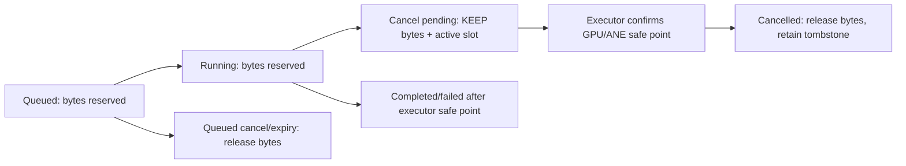

# Miki Engine native session core (ABI v1)

This is a **CPU lifecycle/accounting foundation**, not an LLM executor or a
CommonCompute service. Fixed-size C++17 state is exposed through `strata_*`
C symbols for compatibility. No Objective-C, Swift or Python policy is needed
to mutate admission, cancellation, deadlines or terminal token counters.

## What is implemented

- At most 64 metadata records, including terminal tombstones; one active
  request and a bounded FIFO of 1–63 queued requests. Queue admission reserves
  the entire declared worst-phase demand atomically under the native mutex.
- Exact ABI sizes/version, bounded ASCII IDs, nonzero model identities,
  uint64 byte budgets and monotonic deadlines; context ≤65,536 tokens and
  requested output ≤16,384 tokens. These are **current foundation bounds**, not
  family-wide context support. The host must choose smaller validated bounds.
- Token increments may not exceed the requested output. Completion/failure/
  cancellation is terminal exactly once; snapshots copy values rather than
  returning borrowed pointers. Qualification is always false.
- Duplicate IDs are rejected while their records remain. Terminal records
  require explicit forgetting; forgetting does not implement durable replay
  prevention. The authorized host still owns anti-replay and billing records.
- Creation allocates one fixed owner; subsequent operations use bounded scans
  and a mutex, with no explicit per-operation heap allocations. This is not a
  lock-free hot path, measured allocation profile or batching implementation.

## Ownership and safe cancellation



`cancel` does not stop a Metal command buffer, ANE request or a model executor.
The executor must poll `check`, stop producing output and synchronize all
referencing compute work before calling `finish`. Active cancellation requires
a matching cancelled terminal reason. Token updates after cancellation fail.
Queued expiry releases bytes immediately because nothing was dispatched.
Calling `check` on a newly expired queued request reports cancellation; inspect
the snapshot to distinguish immediate terminal cancellation from active pending.

`drain` rejects new submissions but lets admitted FIFO work run. To tear down,
stop ingress, cancel or finish queued/active requests, join all executor threads
and callbacks, then destroy. `destroy` refuses queued/active work; its mutex
cannot protect a foreign caller that keeps using a pointer after destruction.
Wrappers serialize their own handle access. The host must hold ownership for
the whole asynchronous execution, even after a caller disconnects.

## Trusted ABI, not a security perimeter

Descriptors contain no prompts, ciphertext, weights, tensor pointers, URLs,
filesystem paths, keys or runnable code. A nonzero digest is only an identity:
the native core does not verify signatures, authorize tenants or calculate a
real model's memory footprint. It accepts **already authorized metadata**.

Before submission, the worker must verify manifests/artifact identity, derive
actual tokenizer token counts and reserve model + worst-phase KV/activation/
temporary/output demand within the live platform budget. Shared model memory
is not deduplicated by this version; supply a conservative, complete reservation
and do not double-spend bytes. Caller-supplied small reservations are not proof
that a workload fits. All deadline values must come from one trusted monotonic
clock. This ABI is in-process, not an untrusted cross-process pointer format.

## Build and bindings

On the approved source checkout, keep compiler output on SSD:

```sh
make -C native/runtime test BUILD_DIR='/Users/tylergee/Library/Application Support/Strata/build/native-session'
```

The native test executable defaults to UBSan. On the local macOS/Xcode build,
the combined ASan/UBSan runtime hung before `main` in ASan initialization; that
run was terminated and **did not pass**. UBSan and normal linked fixtures pass;
ASan must be requalified independently before claiming ASan coverage.

- Python: `miki_engine.native_session.NativeSession` (legacy
  `ollm.runtime.native_session`) uses ctypes; C++ remains the authority.
  The caller supplies a trusted library hash. Its symlink/path and hash check
  is a local integrity check, **not** a replacement for signed bundles or an
  immutable trusted library directory; hash-then-load is not atomic against a
  hostile concurrent writer. This is a development binding, not a loader sandbox.
- Swift: see `integrations/commoncompute/native-session-v1/`; a Swift actor
  contains the Clang-imported handle. The current toolchain uses Swift 6.2's
  isolated deinitializer; older toolchains/deployment targets are unqualified.
- TypeScript: the same directory contains a strict metadata snapshot decoder,
  exact uint64 decimal strings and monotonic observation checks. There is
  **no Node native bridge** or inference RPC in this iteration.

Test with the existing validated Python environment; do not install implicitly:

```sh
PYTHONDONTWRITEBYTECODE=1 PYTHONPATH=src /Users/tylergee/Documents/strata-recovered/.venv/bin/python -m pytest -q -p no:cacheprovider tests/test_native_session.py tests/test_miki_branding.py tests/test_native_build_paths.py
```

## Next bounded implementation gates

1. Link this owner inside an isolated executor, after CommonCompute's existing
   sealed verification/decryption boundary. Preserve `mlx_llm` unchanged.
2. Use MLX first to prove exact token accounting, stop behavior, cancellation,
   timeout, crash-before-output and no-replay-after-partial-output semantics.
   No provider-visible route until signed model and lifecycle acceptance pass.
3. Connect one numerically qualified native FFN/prefill segment with explicit
   GPU completion ownership; compare the identical whole-model workload with
   MLX-LM. Keep ANE compile/dispatch/readback/parity gating separate.
4. Add a binary/text event transport and measured Node bridge only if needed;
   snapshot revisions are not contiguous token-stream sequences or billable
   receipts. Production XPC, model slots, KV isolation, SSD paging, multi-tenant
   reuse and continuous batching remain separate acceptance gates.

No measured full-model TTFT, decode, energy, throughput, SSD or Darkbloom win
is established by these CPU lifecycle tests.
